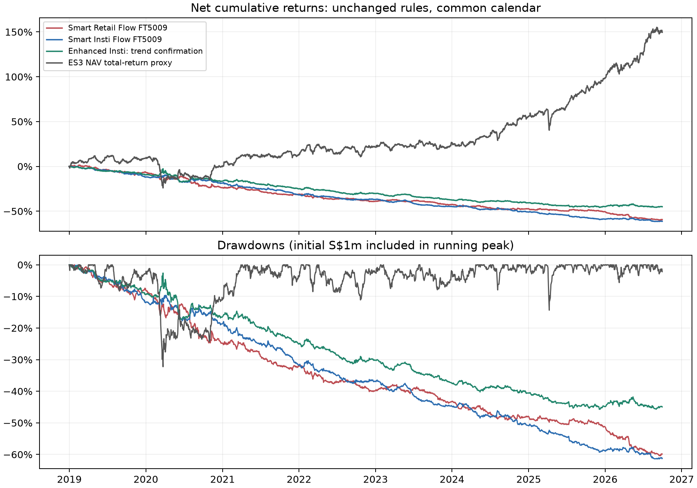
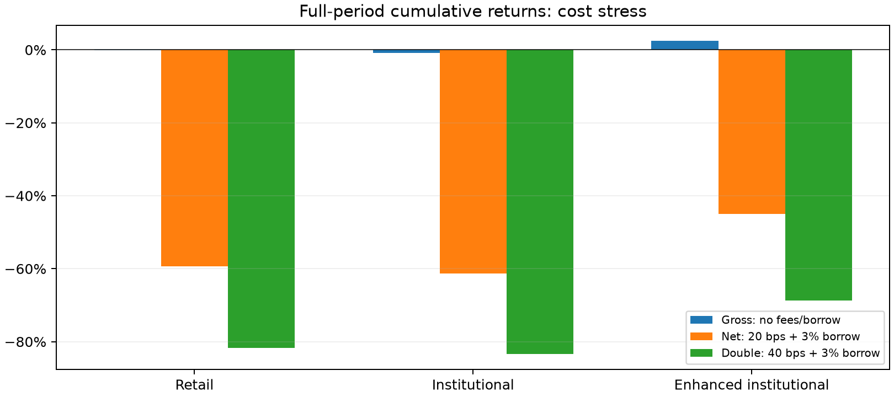

# Member 2 — Institutional enhancement and performance evaluation

Scope: assignment Parts 3 (3 marks), 4 (3 marks), and Member 2's contribution to Part 6. This is a chapter draft; it is not the final group report. The companion PDF is a three-page A4 extract for integration into the group's maximum ten pages. Names and matriculation numbers must be supplied by the group; none are invented.

## 3. Fixed enhancement and common execution

One fixed rule, adapted from FT5009 Lecture 8 (physical PDF pp. 16 and 21): confirm institutional Weekly Top 10 buys when the SGD total-return index is above its 126-session simple moving average (SMA), and sells when it is below. Both the current index and its SMA end on the last benchmark session strictly before the report publication date. Require 126 aligned nonmissing closes; equality or missing history rejects the slot. The total-return index avoids mechanical dividend-date price drops. Six months is a fixed medium-term smoothing horizon, not selected by maximising this sample. The lecture illustrates long/cash price-versus-SMA; we extend it symmetrically to the required long/short institutional flow slots, retaining weekly publication-driven execution. No parameter sweep or full-period optimisation is performed.

All strategies retain Member 1's same 125 fixed pre-2019 canonical histories, 396 reports and 15,840 signals; S$1m initial NAV each; 49% per side, ten 4.9% slots, 10% name cap; no redistribution of rejected/unavailable slots. Existing holdings earn execution-day returns, then rebalance at the first benchmark close strictly after publication. A rejected old holding exits at that rebalance unless zero-volume rules freeze it. Frozen holdings reserve their side budget. Cash/short proceeds earn zero, fractional total-return units and no final liquidation. All borrowable is assumed, with 3% annual calendar-day borrow on prior-close short value. No margin calls or market impact are modelled.

The filter accepted 4769 of 7920 institutional source slots, including unavailable-history slots in the denominator. Decisions and information dates are in enhancement_decisions.csv. Retail and original institutional NAV paths independently match every Member 1 daily NAV across gross/net/doubled costs. Filtering uses a unique absent quote key to preserve ten slots; it never changes vendor prices or source data. Apparent filtered quote exclusions are intentional cash slots, not missing real tickers.

## 4a. Full-period performance

Returns are simple daily SGD portfolio returns on a common 1,945-session calendar. Cumulative return = product(1+r)-1; annualised return = product(1+r)^(252/n)-1. Realised volatility uses sample standard deviation times sqrt(252). Maximum drawdown includes initial wealth in the peak; we report signed negative drawdowns, equivalent to the lecture's positive loss magnitude. Sharpe = mean(r)/sd(r)*sqrt(252), with zero risk-free rate. Sortino = mean(r)/sqrt(mean(min(r,0)^2))*sqrt(252), zero daily target and all n sessions in the downside denominator. Ratios with zero denominators are undefined. Ratios use arithmetic mean, not CAGR. Each subperiod compounds the existing daily path (including its first daily return); strategies are not reset or retuned at period boundaries. Subperiod drawdowns use local initial wealth; actual dollar fees retain the continuing portfolio scale.

Net strategy returns and the benchmark reference:

| strategy | cumulative_return | annualised_return | annualised_volatility | maximum_drawdown | sharpe | sortino |
|---|---|---|---|---|---|---|
| retail | -59.29% | -10.99% | 6.43% | -60.40% | -1.780 | -2.369 |
| institutional | -61.27% | -11.56% | 5.72% | -61.41% | -2.119 | -2.741 |
| enhanced | -44.96% | -7.45% | 5.91% | -45.72% | -1.280 | -1.701 |
| benchmark | 149.56% | 12.58% | 13.25% | -32.26% | 0.961 | 1.357 |

On this restricted sample, retail flow has the higher full-period net cumulative return. The enhancement changes institutional net cumulative return by 16.30 percentage points (-61.27% to -44.96%). Its annualised volatility is 5.91% versus original 5.72%; maximum drawdown is -45.72%, Sharpe -1.280 and Sortino -1.701, versus original institutional Sharpe -2.119. All three strategies lose money after base costs; the enhancement reduces losses and drawdown but does not make this trading rule viable. Its mean gross exposure falls from 86.87% to 59.75%; lower exposure need not improve signal alpha.

## 4b. Prescribed subperiods, unchanged rules

| strategy | 2019–2021 | 2022–2023 | 2024–Sep2026 | full |
|---|---|---|---|---|
| retail | -31.03% | -16.66% | -29.18% | -59.29% |
| institutional | -31.79% | -18.79% | -30.08% | -61.27% |
| enhanced | -25.04% | -16.44% | -12.13% | -44.96% |
| benchmark | 12.83% | 12.36% | 96.85% | 149.56% |

2019–2021: institutional -31.79%, enhanced -25.04% (+6.74 percentage points). 2022–2023: institutional -18.79%, enhanced -16.44% (+2.35 percentage points). 2024–Sep2026: institutional -30.08%, enhanced -12.13% (+17.95 percentage points). The enhancement improves cumulative return in every prescribed subperiod.

All six metrics for every strategy/scenario/subperiod are available in performance.csv; the table above focuses on cumulative returns. Period lengths differ, so consult annualised returns and volatility in that file before comparing magnitudes. Full-period drawdown may span subperiod boundaries and need not equal the worst local drawdown.

## 4c. Costs, turnover and trading feasibility

Gross removes both transaction and borrow fees. Net charges 20 bps of absolute traded notional per side plus 3% annual borrowing; stress doubles transaction cost to 40 bps and keeps borrowing at 3%. All nine paths are rerun rather than subtracting a terminal fee estimate, so costs affect later NAV, sizing and borrow. Gross-to-net includes borrowing, not only transaction costs. Turnover is sum(abs(trade notional)/pre-cost rebalance NAV), annualised by 252/n; no division by two.

Retail: gross -0.15%, net -59.29%, doubled-cost -81.72%; annual one-way turnover 51.77x NAV, mean gross exposure 85.65%. Institutional: gross -0.88%, net -61.27%, doubled-cost -83.32%; annual one-way turnover 54.01x NAV, mean gross exposure 86.87%. Enhanced: gross 2.49%, net -44.96%, doubled-cost -68.77%; annual one-way turnover 36.44x NAV, mean gross exposure 59.75%.

Retail: 785/9787 trades exceed 1% of execution-day vendor volume; maximum 31886.09%; lagged ADV21 maximum 84.97%; 25 orders exceed 100% of reported daily volume. Institutional: 543/9859 trades exceed 1% of execution-day vendor volume; maximum 6088.77%; lagged ADV21 maximum 86.92%; 18 orders exceed 100% of reported daily volume. Enhanced: 421/7415 trades exceed 1% of execution-day vendor volume; maximum 3164.38%; lagged ADV21 maximum 14.35%; 7 orders exceed 100% of reported daily volume.

Execution-day participation = abs(SGD notional)/(SGD vendor close * vendor share volume). ADV21 participation uses the mean of 21 aligned preceding sessions of vendor dollar volume, shifted one session; missing/zero ADV is unavailable, not zero. We report 1%/5% flags as diagnostic levels, not guaranteed executable limits. Full trade-level figures, period summaries, notional-weighted 1% exceedance shares and missing-ADV counts are in trades_and_liquidity.csv.gz and liquidity_summary.csv. Exposure reduction partly explains changed performance and turnover; this is not a constant-exposure alpha comparison.

## Limitations, conclusion and Member 3 handoff

These are descriptive restricted-sample results, not a causal test that investor type predicts returns. No development/test split is required by the assignment; no claim of out-of-sample validation is made. The ES3 official NAV/distribution reinvestment proxy is suitable SGD market context but is long-only, has different market exposure, and is neither the official STI total-return index nor an executable ETF-price portfolio. The strategies' Sharpe comparisons do not adjust for beta or unequal realised exposure. Inherited missing/delisted histories, fixed-universe/survivorship bias, candidate identities, current vendor vintages, uncertain publication timestamps, corporate actions and lagged FX remain. Vendor split-adjusted price/volume pairs approximate turnover capacity, not certified exchange dollar volume. Execution-day participation is ex-post; strictly lagged 21-session mean dollar volume is a separate planning proxy. No liquidity filter is silently imposed. Fixed fees omit spread variation, nonlinear impact, borrow recalls and actual availability. Profitable cost-stress paths are therefore not proof of implementability, and negative paths fail this simplified viability test. Orders exceeding 100% of reported daily volume could not be fully executed within that day on the recorded volume basis. They expose an unconstrained-fill limitation or a vendor-basis issue requiring investigation, not merely a modest slippage adjustment; see liquidity_extreme_trades.csv. No claim of executable profits is justified.

On this restricted sample, retail flow has the higher full-period net cumulative return. The enhancement changes institutional net cumulative return by 16.30 percentage points (-61.27% to -44.96%). Its annualised volatility is 5.91% versus original 5.72%; maximum drawdown is -45.72%, Sharpe -1.280 and Sortino -1.701, versus original institutional Sharpe -2.119. All three strategies lose money after base costs; the enhancement reduces losses and drawdown but does not make this trading rule viable. Its mean gross exposure falls from 86.87% to 59.75%; lower exposure need not improve signal alpha. 2019–2021: institutional -31.79%, enhanced -25.04% (+6.74 percentage points). 2022–2023: institutional -18.79%, enhanced -16.44% (+2.35 percentage points). 2024–Sep2026: institutional -30.08%, enhanced -12.13% (+17.95 percentage points). The enhancement improves cumulative return in every prescribed subperiod. A conclusion about improvement must state the costs, volatility, drawdown and period instability together; a single return ranking is insufficient.

The enhanced strategy has 0 active start-of-day holding rows on Member 1's unverified >50% return observations; see risk_handoff/active_flagged_returns.csv. This check does not certify vendor returns or justify deleting outliers. Separate quarantined risk returns preserve missing observations. Exact 500-session history gaps are {"enhanced": 19, "institutional": 46, "retail": 82}. Member 3 must compute signed-holdings 99% historical VaR and rolling risk analysis; this chapter does not claim Part 5 is complete. Compressed net holdings for all three strategies, daily NAV/cost paths, quarantined aligned returns and forecast coverage are provided. Do not drop dates or fill missing returns with zero.

## Sources, attribution and reproducibility

- Assignment: FT5009 Group Project AY2026/27, supplied group_project.pdf, Parts 3–4 and 6.
- SGX Weekly Top 10 source reports, official ES3 NAV/distributions, vendor prices and source checksums: Member 1's collected data, README.md and REQUIREMENTS_AUDIT.md. Source portal: https://www.sgx.com/stock-exchange/data-reports?reportType=203 .
- FT5009 Lecture 8, supplied FT5009_L08.pdf: physical PDF pp. 16 and 21 (SMA and price-versus-average strategy), pp. 42–47 (performance formulas), pp. 52–54 (bias, overfitting and realistic costs). The lecture illustrates short windows and a long/cash rule; 126 daily sessions, SGD total-return inputs and symmetric short confirmation are our stated adaptations.
- FT5009 Lecture 2, supplied FT5009_L02.pdf, physical PDF pp. 16–18: missing data, outlier review and point-in-time information. FT5009 Lecture 7, supplied FT5009_L07_upload.pdf, physical PDF pp. 12 and 16–17: impact, order-book depth and execution liquidity.
- AI assistance: OpenAI Codex assisted with implementation, tests, analysis and draft writing. Members must review the work, verify course alignment and take responsibility for final submitted claims. Member 1 retains credit for original collection and baseline engine; Member 2 adds enhancement, evaluation, charts, tests and this chapter.

Run instructions are in ../README.md. validation.json records source hashes, versions and conventions; artifact_sha256.json records output checksums. The supplied chat-share link could not be retrieved in this environment and is not a source for any claimed requirement.
